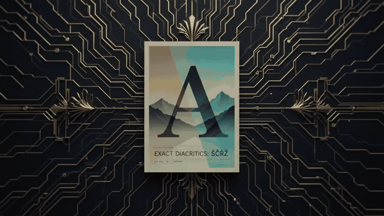

# Smart Prompt: Art Director pro obří typografické plakáty

> Online článek a kontext na Vibemaker: [Art Director: Giant Typographic Poster](https://vibemaker.cz/clanek/typo-art-postery/)

  

[English](README.md)

Vizuální prompt, který uživatele provede 5bodovým kreativním briefem a sestaví přesný anglický prompt pro generování celostránkových plakátů ve stylu Giant Typographic se zachováním přesné české či jiné diakritiky.

## Spuštění

1. Otevřete soubor [cs/smart-prompt-typo-art-postery.md](cs/smart-prompt-typo-art-postery.md) (nebo anglickou verzi [en/smart-typo-art-posters.md](en/smart-typo-art-posters.md)).
2. Zkopírujte celý obsah souboru a vložte jej jako systémový prompt nebo první zprávu do svého AI asistenta (ChatGPT, Claude, Gemini či jiného kompatibilního nástroje).
3. Odpovězte na vstupní diagnostické otázky z Fáze 1. Stop-pojistka zakazuje generovat finální prompt či obrázek před zodpovězením 5 otázek briefu (motiv, písmeno, přesný text, textura pozadí, paleta a poměr stran).

## Funkce

- Kombinuje jedno monumentální patkové nebo bezpatkové písmeno, realistický fotografický motiv ve dvojité expozici, barevné překryvy a archivní papír.
- Vynucuje čistý tisk bez rámečků a maket místností (`no frame, no mockup, no wall, edge-to-edge graphic print`).
- Chrání přesný pravopis a diakritiku zadaného textu na plakátu pomocí doslovného vložení v uvozovkách.
- Spouští integrovaný generátor obrázků (pokud je v modelu dostupný) a nabízí 3 konkrétní návrhy pro další iteraci.

## Co projekt není

Tento repozitář je specifikace promptu, nikoli samotný obrazový generátor nebo vektorový editor. Přesnost vykreslení písma závisí na možnostech cílového modelu.

## Jazyky

Anglická verze `en/smart-typo-art-posters.md` i česká verze `cs/smart-prompt-typo-art-postery.md` vedou brief v příslušném jazyce a finální zadání pro obrazový generátor sestavují v angličtině.

## Data a soukromí

Pouze statické Markdown soubory bez telemetrie, účtů a externích zdrojů.

## Soubory

| Soubor | Účel |
|---|---|
| [cs/smart-prompt-typo-art-postery.md](cs/smart-prompt-typo-art-postery.md) | Česká varianta promptu |
| [en/smart-typo-art-posters.md](en/smart-typo-art-posters.md) | Anglická varianta promptu |
| [README.md](README.md) | Anglická dokumentace |
| [README.cs.md](README.cs.md) | Česká dokumentace |
| [CHANGELOG.md](CHANGELOG.md) | Historie verzí |
| [LICENSE](LICENSE) | Veřejné uvolnění CC0 1.0 Universal |

## Licence a autor

Texty promptů i dokumentace jsou uvolněny jako volné dílo pod licencí [CC0 1.0 Universal](LICENSE). Uvedení autora má informační charakter.

### Autor

**Luděk Sušický** — biolog, středoškolský a vysokoškolský učitel informatických předmětů

- E-mail: [ludek.susicky@gmail.com](mailto:ludek.susicky@gmail.com)
- X: [@ludeksusicky](https://x.com/ludeksusicky)
- LinkedIn: [Luděk Sušický](https://www.linkedin.com/in/ludek-susicky/)
- GitHub: [@siberius](https://github.com/siberius) — další vzdělávací projekty a otevřené aplikace

[Repozitář na GitHubu](https://github.com/siberius/smart-typo-art-posters)
